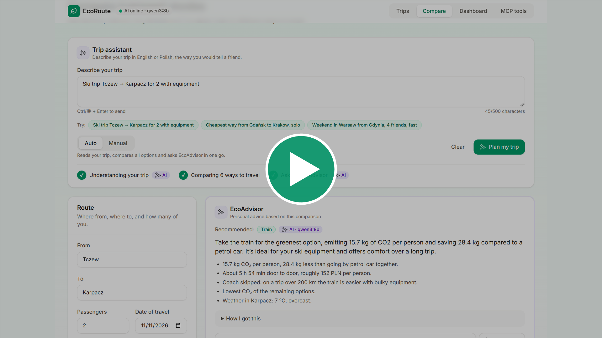

# EcoRoute

**EcoRoute compares ways to travel the same route by time, cost and carbon footprint.** Enter where you start, where you're going and how many people are travelling. EcoRoute compares a petrol car, an electric car, train, coach, plane and bike, and lets you keep a history of your trips.

A local LLM (via [Ollama](https://ollama.com)) parses free-text trips and acts as an advisor. The core rule: **the LLM never calculates emissions.** Deterministic code does the maths; the model only picks tools and explains the results. Every AI feature has a rule-based fallback, so the app works without a model.

## Contents

- [Demo](#demo)
- [Features](#features)
- [How I used AI](#how-i-used-ai)
- [Getting started](#getting-started)
- [Technical overview](#technical-overview)
- [Checks and CI](#checks-and-ci)

## Demo

▶ Watch the demo below. (The quality is kind of "meh" to keep the size of the file small.)
[](https://github.com/KamilFischbach/EcoRouteFinder/raw/main/ecoMin1080.mp4)

The video file is in the repo: [ecoMin1080.mp4](https://github.com/KamilFischbach/EcoRouteFinder/raw/main/ecoMin1080.mp4) (~8 MB, click to download; GitHub can't preview files this large).

## Features

- [x] Trip history: add, edit, delete (with confirmation), filter by transport mode, travel date, CO₂ per person for each trip
- [x] Mode comparison: time, cost and kg CO₂ per person for six modes, with Greenest / Fastest / Cheapest picks, a CO₂ chart and one-click "Save trip"
- [x] Real routes from OpenStreetMap (Nominatim + OSRM) with an offline fallback estimate
- [x] Comparison history: every comparison is saved as a snapshot, linkable at `/compare/:id`
- [x] Trip assistant: describe the trip once (English or Polish); **Auto** compares and asks EcoAdvisor in one go, **Manual** only fills in the form
- [x] EcoAdvisor: a tool-calling agent that recommends one option, checks the weather and explains why, taking your preferences (luggage, skis, comfort, budget, speed) into account, with a rule-based fallback
- [x] MCP server: the same tools as EcoAdvisor plus `get_trip_stats`, over stdio (Claude Desktop, MCP Inspector) and Streamable HTTP, with an **MCP tools** page in the app that is a real MCP client
- [x] REST API with validation and a consistent error format
- [x] Dashboard: CO₂ footprint over time, CO₂ saved vs petrol car, CO₂ by mode, eco-points and levels, best trip

### Creative twist

**An eco travel advisor that is not allowed to do maths.** EcoRoute doesn't just list numbers; it tells you which way to travel and why, and every number it says comes from deterministic code.

- **Describe your trip in one sentence** (English or Polish), e.g. _"Ski trip Tczew → Karpacz for 2 with equipment"_. A local LLM (Ollama) extracts the route, group size and what matters to you; a regex parser takes over when no model is running.
- **EcoAdvisor** compares six modes, checks the weather at the destination and recommends one practical option. It uses tools (comparison, emissions, weather) instead of guessing, its pick is checked against rules (no bike with skis or in the rain), and a summary with wrong numbers or false claims ("the cheapest") is rejected. Every answer shows whether it came from the AI or the rule-based fallback, plus a "How I got this" trace.
- **CO₂ saved vs CO₂ used by the same group by petrol car**: going by train with a friend is compared with the two of you sharing a car, not with driving alone.
- **Eco-points and levels** (Seedling → Forest): 10 points per kg of CO₂ saved, never negative, on a dashboard with your footprint over time.
- **The same tools for any AI agent**: an MCP server exposes them, so Claude Desktop can answer "how much CO₂ did I save this month?" with the dashboard's numbers. The **MCP tools** page in the app is a live MCP client.

## How I used AI

I built EcoRoute with **Claude Code** (VS Code extension) as a pair programmer, and I made the architecture and product decisions myself.

- **Rules first.** Before any feature code the repo got [AGENTS.md](AGENTS.md), the source of truth for agents: layers and what each may not do, naming, test requirements, AI rules ("the LLM never calculates", "always a fallback") and a Definition of Done. [CLAUDE.md](CLAUDE.md) adds Claude-specific habits: small steps, run every check before saying "done", don't add dependencies without a reason, Windows/PowerShell commands.
- **Plan, approve, then build in stages.** Each feature started as a written task with goals, definitions and stages. Claude proposed a plan, raised conflicts with AGENTS.md (e.g. how to migrate the database) and asked about open decisions; I approved or corrected it. Each stage ended with the full lint, type and test run and its own Conventional Commit.
- **Checked, not trusted.** I reviewed every change, tested the app by hand and asked for fixes (layout, wording, UX details). When an API looked unfamiliar (Vite 8, Vitest 5, MSW 3, the MCP SDKs), Claude read the installed package's code and types instead of relying on memory.
- **AI inside the app** runs on a local model via Ollama (`qwen3:8b`), never on a paid API, and each AI feature has a rule-based fallback, so the app works fully offline.

## Getting started

### Quick start: one command (Docker)

Requirements: [Docker](https://docs.docker.com/get-docker/) with Compose.

```bash
docker compose up --build
```

- App: http://localhost:5173
- API docs: http://localhost:8000/docs
- Demo data for the dashboard (optional, in a second terminal): `docker compose exec backend python -m app.seed`
- Trips are kept in the `ecoroute-data` volume; `docker compose down -v` deletes them.
- Ollama is optional (see [step 3](#3-optional-local-ai-with-ollama)); if it runs on the host, the backend container finds it via `host.docker.internal`.

### Manual setup

Requirements: **Python 3.12+**, **Node.js 22+**, Git. Commands are for **bash** (Linux, macOS, Git Bash); the Windows PowerShell version follows each block.

#### 1. Backend (API on http://localhost:8000)

```bash
cd backend
python3.12 -m venv .venv
source .venv/bin/activate
pip install -r requirements-dev.txt
cp .env.example .env                   # optional, defaults work
uvicorn app.main:app --reload
```

PowerShell:

```powershell
cd backend
py -3.12 -m venv .venv
.\.venv\Scripts\Activate.ps1
pip install -r requirements-dev.txt
Copy-Item .env.example .env            # optional, defaults work
uvicorn app.main:app --reload
```

- Interactive API docs: http://localhost:8000/docs
- Health check: http://localhost:8000/api/v1/health
- The SQLite file `backend/ecoroute.db` is created on first start. An older file is upgraded in place on start; you never need to delete it.
- Demo data for the dashboard (optional): `python -m app.seed` adds 30 example trips; it refuses a database that already has trips (see [DETAILS.md](DETAILS.md#dashboard)).

> If PowerShell blocks `Activate.ps1`, run `Set-ExecutionPolicy -Scope CurrentUser RemoteSigned` once, or skip activation and call the venv directly: `.\.venv\Scripts\python -m uvicorn app.main:app --reload`.

#### 2. Frontend (app on http://localhost:5173)

In a second terminal:

```bash
cd frontend
npm install
cp .env.example .env.local             # optional; PowerShell: Copy-Item .env.example .env.local
npm run dev
```

`VITE_API_URL` defaults to `http://localhost:8000/api/v1`.

#### 3. Optional: local AI with Ollama

Install [Ollama](https://ollama.com/download), then pull the model once:

```bash
ollama pull qwen3:8b
ollama list                            # should show qwen3:8b
```

Ollama runs in the background on `http://localhost:11434`. Restart nothing: the backend checks for the model every 30 s, and the header switches to **AI online · qwen3:8b**.

**Without Ollama the app still works.** The header shows **AI offline (rule-based)**, the trip assistant uses regex rules, and EcoAdvisor uses a rule-based recommender. Set `AI_ENABLED=false` to never contact Ollama. Ollama 0.9.0 or newer is needed for `OLLAMA_THINK`: every chat request sends `"think": false`, because Qwen3 thinks by default, which is much slower and (on 0.9.x) puts `<think>…</think>` text into the answer, breaking the JSON output. An 8B model on CPU can take 10-30 s per answer; with a GPU it's 1-3 s (the first call also loads the model).

All settings have working defaults; they are listed in [DETAILS.md](DETAILS.md#configuration) and in `backend/.env.example`.

## Technical overview

- **Backend:** Python 3.12, FastAPI, SQLModel and SQLite, in layers: router → service → repository → database. Services never import FastAPI; all CO₂, cost and time maths is deterministic code.
- **Frontend:** React 19, TypeScript (strict), Vite, TanStack Query, Tailwind CSS 4, Recharts.
- **AI:** a local LLM via Ollama for the trip parser and EcoAdvisor, each with a rule-based fallback; an MCP server exposes the same tools to any AI agent.
- **Quality:** pytest, ruff and mypy (strict); Vitest, React Testing Library and MSW; a GitHub Actions workflow runs all checks on every push (see [Checks and CI](#checks-and-ci)).

Everything else (project structure, configuration, the REST API, how emissions are calculated, route fallbacks, the dashboard maths, the AI and MCP design, how to run the tests) is in **[DETAILS.md](DETAILS.md)**.

### Checks and CI

**CI status: the GitHub Actions runs currently fail before any step starts**, because my GitHub account is blocked from running Actions (a billing/payment problem on the account, not a code problem). The workflow is in [.github/workflows/ci.yml](.github/workflows/ci.yml) and runs exactly the checks below.

Last full local run (2026-11-12, Windows 11, Python 3.13, Node 24), all passing:

| Check | Command | Result |
|---|---|---|
| Backend lint | `ruff check .` | All checks passed |
| Backend format | `ruff format --check .` | 79 files already formatted |
| Backend types | `mypy app` (strict) | No issues in 50 source files |
| Backend tests | `pytest` | 456 passed |
| Frontend lint | `npm run lint` (ESLint + Prettier) | Passed |
| Frontend types | `npm run typecheck` | Passed |
| Frontend tests | `npx vitest run` | 120 passed (17 files) |
| Frontend build | `npm run build` | Built |

To run them yourself: `ruff check . && ruff format --check . && mypy app && pytest` in `backend/`, and `npm run lint && npm run typecheck && npx vitest run && npm run build` in `frontend/` (in Windows PowerShell 5.1 use `;` instead of `&&`).
