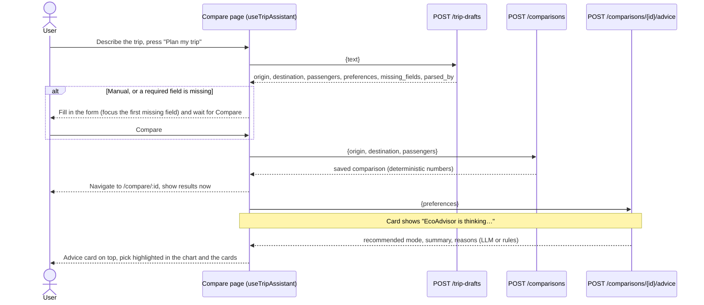
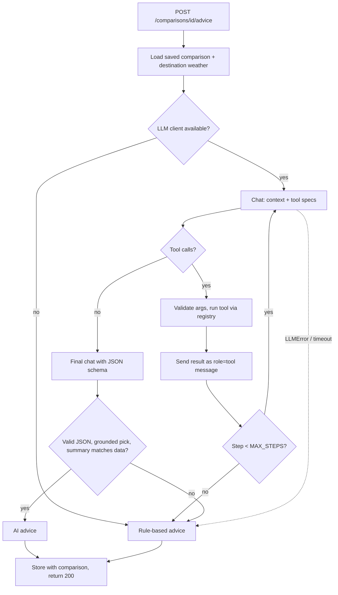

# EcoRoute

[](https://github.com/KamilFischbach/EcoRouteFinder/actions/workflows/ci.yml)

**EcoRoute compares ways to travel the same route by time, cost and carbon footprint.** Enter where you start, where you're going and how many people are travelling. EcoRoute compares a petrol car, an electric car, train, coach, plane and bike, and lets you keep a history of your trips.

> **Status:** trip history, CO₂ per trip, the mode comparison with saved history, and the AI features (free-text trip parser and the EcoAdvisor agent on a local LLM) the dashboard and an MCP server for AI agents work end to end. The map is next.

A local LLM (via [Ollama](https://ollama.com)) will parse free-text trips and act as an advisor. The core rule: **the LLM never calculates emissions.** Deterministic code does the maths; the model only picks tools and explains the results. Every AI feature has a rule-based fallback, so the app works without a model.

## Features

- [x] Trip history: add, edit, delete (with confirmation), filter by transport mode, travel date, CO₂ per person for each trip
- [x] Mode comparison: time, cost and kg CO₂ per person for six modes, with Greenest / Fastest / Cheapest picks, a CO₂ chart and one-click "Save trip"
- [x] Real routes from OpenStreetMap (Nominatim + OSRM) with an offline fallback estimate
- [x] Comparison history: every comparison is saved as a snapshot, linkable at `/compare/:id`
- [x] Trip assistant: describe the trip once (English or Polish); **Auto** compares and asks EcoAdvisor in one go, **Manual** only fills in the form
- [x] EcoAdvisor: a tool-calling agent that recommends one option, checks the weather and explains why, taking your preferences (luggage, skis, comfort, budget, speed) into account, with a rule-based fallback
- [x] MCP server: the same tools as EcoAdvisor plus `get_trip_stats`, over stdio (Claude Desktop, MCP Inspector) and Streamable HTTP, with an **MCP tools** page in the app that is a real MCP client
- [x] REST API with validation and a consistent error format
- [x] Dashboard: CO₂ footprint over time, CO₂ saved vs petrol car, CO₂ by mode, eco-points and levels, best trip

## Creative twist

_Coming soon._

## Tech stack

| Area | Tools |
|---|---|
| Backend | Python 3.12, FastAPI, SQLModel, SQLite, pydantic-settings |
| Backend quality | pytest + httpx, ruff (lint + format), mypy (strict) |
| Frontend | Vite, React 19, TypeScript (strict), React Router, TanStack Query, Tailwind CSS 4 |
| Frontend quality | Vitest, React Testing Library, MSW, ESLint, Prettier |
| AI | Local LLM via [Ollama](https://ollama.com) 0.9+ (`qwen3:8b`, thinking off) over plain `httpx`: structured output + tool calling |
| MCP | Official SDKs: `mcp` (Python server, stdio + Streamable HTTP), `@modelcontextprotocol/client` (web client) |
| External data | OpenStreetMap Nominatim + OSRM (routes), Open-Meteo (weather); no API keys |
| Planned | react-leaflet (map) |
| CI | GitHub Actions (parallel backend and frontend jobs) |

## Project structure

```
backend/
  app/
    main.py            # create_app(): CORS, error handlers, routers
    core/              # settings, domain errors
    db.py              # engine, session dependency, init_db
    models/            # SQLModel tables
    schemas/           # request/response DTOs + validation
    repositories/      # database access
    services/          # business logic: trips, comparisons + snapshots, emissions + factors, routing, weather, advice, stats + eco-points
    ai/                # LLM client (Ollama), prompts, tool registry, trip parser + rules, advisor agent
    mcp_server.py      # MCP server over the tool registry: `python -m app.mcp_server` (stdio), /mcp (HTTP)
    api/v1/            # routers: health, trips, comparisons (+ advice), trip-drafts, stats
    seed.py            # `python -m app.seed`: demo trips for the dashboard
  tests/               # api/ and unit/ tests (in-memory SQLite)
frontend/
  src/
    api/               # fetch client, endpoint functions
    components/        # shared UI components
    features/trips/    # trip form, table, validation, TanStack Query hooks
    features/assistant/ # trip assistant: text box, Auto/Manual switch, step progress, useTripAssistant hook
    features/compare/  # compare form, results, CO2 chart, history, EcoAdvisor card
    features/ai/       # AI status badge (polls /health)
    features/dashboard/ # stats query, range switch, KPI tiles, level, charts, best trip, summary text
    features/mcp/      # MCP tools page: tool cards, forms built from JSON schema, MCP badge
    lib/               # formatting, shared validators, helpers
    pages/             # Trips, Compare, Dashboard, MCP tools
    types/             # shared TypeScript types
    test/              # Vitest setup, MSW handlers
.github/workflows/ci.yml
AGENTS.md              # rules for AI agents and contributors
CLAUDE.md              # Claude-specific notes (points to AGENTS.md)
```

Architecture: requests flow **router → service → repository → database**. Routers never touch the DB session, and services never know about HTTP. See [AGENTS.md](AGENTS.md) for the full rules.

## Getting started

Requirements: **Python 3.12+**, **Node.js 22+**, Git. Commands are for **PowerShell**; bash variants are in comments.

### 1. Backend (API on http://localhost:8000)

```powershell
cd backend
py -3.12 -m venv .venv                 # bash: python3.12 -m venv .venv
.\.venv\Scripts\Activate.ps1           # bash: source .venv/bin/activate
pip install -r requirements-dev.txt
Copy-Item .env.example .env            # optional, defaults work; bash: cp .env.example .env
uvicorn app.main:app --reload
```

- Interactive API docs: http://localhost:8000/docs
- Health check: http://localhost:8000/api/v1/health
- The SQLite file `backend/ecoroute.db` is created on first start. An older file is upgraded in place on start; you never need to delete it.
- Demo data for the dashboard (optional, see [Dashboard](#dashboard)): `python -m app.seed`.

> If PowerShell blocks `Activate.ps1`, run `Set-ExecutionPolicy -Scope CurrentUser RemoteSigned` once, or skip activation and call the venv directly: `.\.venv\Scripts\python -m uvicorn app.main:app --reload`.

### 2. Frontend (app on http://localhost:5173)

In a second terminal:

```powershell
cd frontend
npm install
Copy-Item .env.example .env.local      # optional; bash: cp .env.example .env.local
npm run dev
```

`VITE_API_URL` defaults to `http://localhost:8000/api/v1`.

### 3. Optional: local AI with Ollama

Install [Ollama](https://ollama.com/download), then pull the model once:

```powershell
ollama pull qwen3:8b
ollama list                            # should show qwen3:8b
```

Ollama runs in the background on `http://localhost:11434`. Restart nothing: the backend checks for the model every 30 s, and the header switches to **AI online · qwen3:8b**.

**Without Ollama the app still works.** The header shows **AI offline (rule-based)**, the trip assistant uses regex rules, and EcoAdvisor uses a rule-based recommender. Set `AI_ENABLED=false` to never contact Ollama. Ollama 0.9.0 or newer is needed for `OLLAMA_THINK`: every chat request sends `"think": false`, because Qwen3 thinks by default, which is much slower and (on 0.9.x) puts `<think>…</think>` text into the answer, breaking the JSON output. An 8B model on CPU can take 10-30 s per answer; with a GPU it's 1-3 s (the first call also loads the model).

### Configuration

| Variable | Default | Where |
|---|---|---|
| `DATABASE_URL` | `sqlite:///./ecoroute.db` | backend `.env` |
| `CORS_ORIGINS` | `http://localhost:5173` (comma-separated) | backend `.env` |
| `AI_ENABLED` | `true` (falls back to rules when Ollama isn't running) | backend `.env` |
| `OLLAMA_HOST` | `http://localhost:11434` | backend `.env` |
| `OLLAMA_MODEL` | `qwen3:8b` | backend `.env` |
| `OLLAMA_TIMEOUT_S` | `90` (per LLM call) | backend `.env` |
| `OLLAMA_TEMPERATURE` | `0.2` | backend `.env` |
| `OLLAMA_THINK` | `false` (sent as `think` to `/api/chat`; Qwen3 thinking mode) | backend `.env` |
| `WEATHER_URL` | `https://api.open-meteo.com` | backend `.env` |
| `GEOCODER_URL` | `https://nominatim.openstreetmap.org` | backend `.env` |
| `ROUTING_URL` | `https://router.project-osrm.org` | backend `.env` |
| `HTTP_TIMEOUT_S` | `8` | backend `.env` |
| `HTTP_USER_AGENT` | `EcoRoute/0.1 (+https://github.com/KamilFischbach/EcoRouteFinder)` | backend `.env` |
| `VITE_API_URL` | `http://localhost:8000/api/v1` | frontend `.env.local` |

`HTTP_USER_AGENT` identifies the app to Nominatim, as its [usage policy](https://operations.osmfoundation.org/policies/nominatim/) requires. If you deploy EcoRoute, set your own value (a URL, not an email).

## API

| Method | Path | Description |
|---|---|---|
| `GET` | `/api/v1/health` | `{status, ai_available, ai_model}` |
| `GET` | `/api/v1/trips?mode=` | List trips, latest travel date first, optional mode filter |
| `POST` | `/api/v1/trips` | Create a trip → `201`. `travelled_on` (`YYYY-MM-DD`) defaults to today and cannot be in the future (`422`) |
| `GET` | `/api/v1/trips/{id}` | Get one trip → `404` if missing |
| `PUT` | `/api/v1/trips/{id}` | Update the fields sent in the body |
| `DELETE` | `/api/v1/trips/{id}` | Delete → `204` |
| `POST` | `/api/v1/comparisons` | Compare all modes for `{origin, destination, passengers, distance_km?}` and save it → `201` |
| `GET` | `/api/v1/comparisons?limit=20&offset=0` | History, newest first (summary rows) |
| `GET` | `/api/v1/comparisons/{id}` | A saved comparison (snapshot + advice) → `404` if missing |
| `DELETE` | `/api/v1/comparisons/{id}` | Delete → `204` |
| `POST` | `/api/v1/comparisons/{id}/advice` | Ask EcoAdvisor, optional `{preferences}` (max 300 chars). Always `200` (LLM or rules); stored with the comparison |
| `GET` | `/api/v1/stats?range=90d` | Dashboard statistics for `30d`, `90d` (default), `12m` or `all` → see [Dashboard](#dashboard). Unknown range → `422` |
| `POST` | `/api/v1/trip-drafts` | `{text}` (1-500 chars) → form pre-fill `{origin, destination, passengers, mode, preferences, missing_fields, parsed_by}`. Stores nothing |

Errors always use one shape: `{"error": {"code": "NOT_FOUND", "message": "...", "details": ...}}`. Codes are upper case: `NOT_FOUND`, `VALIDATION_ERROR`, `UNKNOWN_PLACE` (422), `ROUTE_TOO_SHORT` (422), `SERVICE_UNAVAILABLE` (503), `INTERNAL_ERROR`.

## How emissions are calculated

All the maths is in [`backend/app/services/emissions.py`](backend/app/services/emissions.py); every factor and its source is in [`transport_factors.py`](backend/app/services/transport_factors.py). No LLM is involved.

**Everything is per person.** For cars, the vehicle's CO₂ and cost are split between the passengers. Train, coach and plane factors already apply per passenger-km, so they don't depend on group size. **CO₂ saved** (`co2_saved_vs_petrol_car_kg`) compares each option with **the same group going together by petrol car**, per person: for 2 people on 293 km the petrol car is 23.7 kg each, the train 9.3 kg, so the train saves 14.3 kg per person. The petrol car itself is the baseline (0), and a fuller car shrinks the saving, because car emissions are shared and train emissions aren't. Numbers shown as text (UI, advisor reasons, the strings the LLM quotes) are rounded in one place, `services/formatting.py`, the same way as the UI: "5 h 54 min", "152 PLN", "15.7 kg".

| Mode | CO₂ factor | Source |
|---|---|---|
| Petrol car | 0.16152 kg CO₂e per vehicle-km | DESNZ 2026, average petrol car |
| Electric car | ≈0.113 kg CO₂ per vehicle-km | 0.205 kWh/km (implied by DESNZ 2026 BEV factor ÷ UK grid factor) × 0.553 kg CO₂/kWh (KOBiZE, Polish grid, 2024 data, published Dec 2025) |
| Train | 0.03092 kg CO₂e per passenger-km | DESNZ 2026, UK national rail |
| Coach | 0.03948 kg CO₂e per passenger-km | DESNZ 2026, coach |
| Plane | 0.22928 kg CO₂e per passenger-km | DESNZ 2026, domestic flight, average passenger, **with radiative forcing (RFI)** |
| Bike | 0 | - |

DESNZ = UK Department for Energy Security and Net Zero, [GHG conversion factors 2026](https://www.gov.uk/government/publications/greenhouse-gas-reporting-conversion-factors-2026) (flat file, revised July 2026). Direct emissions only: well-to-tank (fuel production) is excluded for every mode.

**Assumptions and simplifications**

- The train factor is the UK average. Polish electric rail runs on a more coal-heavy grid, so real train emissions in Poland are likely higher. Treat the number as an approximation.
- One flight factor (domestic) is used for all distances. Longer flights have lower per-km factors, so long flights are overestimated.
- EV emissions use the average Polish grid, not the time of charging or a home solar setup.
- Costs (PLN/km) and speeds are rough estimates marked `approx.` in the code: fuel or electricity only for cars (no depreciation, tolls or parking), typical fares for public transport. Times add a fixed overhead: 15 min for train and coach, 120 min for the airport.
- Practical limits: bikes over 100 km and flights under 300 km are marked "not practical"; a car takes at most 5 people. Greenest / Fastest / Cheapest are picked only from practical options.

## Route data and fallback

1. **Geocoding:** place names are looked up with [Nominatim](https://nominatim.org) (OpenStreetMap). Results are cached in memory, and requests are throttled to 1 per second as its usage policy asks.
2. **Driving route:** distance and driving time come from the public [OSRM](https://project-osrm.org) server.
3. **Distance per mode:** cars and coach use the road distance. Train, bike and plane use the straight-line (great-circle) distance × a detour factor (train 1.2, bike 1.2, plane 1.0 because DESNZ flight factors are meant for great-circle distance).
4. **Fallbacks:**
   - OSRM down or no route: road distance = straight-line distance × 1.25, shown with an **estimated** badge.
   - A place can't be found: `UNKNOWN_PLACE` (422).
   - Nominatim unreachable: `SERVICE_UNAVAILABLE` (503). The UI suggests entering the distance by hand.
   - User enters a distance under **Advanced**: no network calls at all.

Public Nominatim and OSRM servers are fine for a demo but not for heavy traffic. For production, point `GEOCODER_URL` / `ROUTING_URL` at your own instances.

## Comparison history and snapshots

Every comparison is saved (`comparison` table) and gets a linkable URL, `/compare/:id`. The result is stored as a **versioned JSON snapshot** of the options and highlights, because emission factors may change later and the history should show what you saw at the time. Opening a saved comparison reads the snapshot; nothing is recomputed. A few values (greenest mode and its CO₂, the petrol-car baseline, EcoAdvisor's pick) are also stored as plain columns, so the "Recent comparisons" list stays cheap. EcoAdvisor's latest answer is stored with its comparison.

The table is created by `init_db()` at startup. Snapshot version 2 renamed the savings field and the `solo_car_co2_kg` column (now `petrol_car_co2_kg`, the same group by petrol car). An older `ecoroute.db` is **upgraded in place on the next start**, keeping trips, history and advice: the old petrol-car option already holds the group's CO₂ per person, so the new savings are recomputed exactly.

## Dashboard

`/dashboard` shows how your carbon footprint changes over time and how much CO₂ you saved by choosing low-carbon transport. The data comes from your **saved trips**, grouped by their **travel date** (`travelled_on`). All numbers come from `GET /api/v1/stats` and are computed by deterministic code in `services/stats.py` (a pure function, ready to be exposed as an MCP tool). No LLM is involved, and the UI does not recalculate anything.

**Definitions**

- **CO₂ footprint** = the sum of `co2_kg` of the trips in the range. `co2_kg` is **per person** (a car's emissions are split between its passengers). Old trips without a value are computed on the fly.
- **CO₂ saved vs petrol car** (per trip) = CO₂ of the **same group going by petrol car** over the same distance, per person, minus the trip's CO₂. It is computed on the fly, never stored. A flight usually saves a negative amount, and the total is **net**: when it is below zero, the dashboard says e.g. "12 kg more than going by petrol car".
- **Km not driven** = the distance of trips that were not made by petrol car.
- **Eco-points** = 10 points per kg of CO₂ saved on a trip, rounded, and **never below 0 per trip** (no penalties). Points count the trips in the selected range.
- **Levels** (`services/eco_points.py`): Seedling 0, Sprout 250, Sapling 1,500, Tree 4,000, Forest 8,000 points. A threshold is reached when hit exactly.
- **Ranges:** 30 and 90 days end today and are drawn by week (Monday to Sunday); 12 months start on the 1st of the month 11 months ago and are drawn by month, like All time. Empty weeks and months are shown as zero. Footprint and savings are compared with the **previous period of the same length** (not for All time). The **best trip** is the one that saved the most (none if no trip saved anything).

**Simplifications:** a trip's distance is the distance of the chosen mode (e.g. the rail distance for a train trip), and the petrol-car baseline uses that same distance rather than the road distance. Footprint is per person, so a group trip counts once, not once per traveller. The range ends on the UTC date, so a trip dated "today" just after midnight east of UTC moves the range end one day forward.

**Demo data.** To see the dashboard without entering trips by hand, add 30 demo trips between Polish cities from the last four months (mostly trains, some cars and bikes, two flights). Their CO₂ is computed by the same `TripService`. The command refuses to run when the database already has trips; `--force` adds the demo trips next to them and never deletes anything.

```powershell
cd backend
.\.venv\Scripts\python -m app.seed           # bash: python -m app.seed
.\.venv\Scripts\python -m app.seed --force   # add even if trips exist
```

## Trip assistant

The Compare page starts with one box: describe the trip the way you'd tell a friend, in English or Polish, e.g. *"I want to go skiing with my girlfriend from Tczew to Karpacz. We have ski equipment and comfort matters to us."*

| Mode | What happens |
|---|---|
| **Auto** (default) | Reads the trip, compares all six ways to travel, opens the result at `/compare/:id` and asks EcoAdvisor with your preferences, all in one go. If something required is missing (say, the destination), it stops, fills in what it found, focuses the missing field and tells you what to add; pressing **Compare** carries on. |
| **Manual** | Only fills in the form (route, group size and **What matters to you?**) and highlights it. You check it and press **Compare**. |

The switch remembers your choice in the browser. Whichever way a comparison starts (Auto, Manual, or typing into the form yourself), EcoAdvisor is asked automatically with the "What matters to you?" text. Opening a saved comparison from the history doesn't call the model again; it shows the stored advice or an **Ask EcoAdvisor** button.

A progress bar shows three steps, each *waiting*, *in progress*, *done*, *skipped* or *failed*: **Understanding your trip** (with an **AI** or **rules** badge), **Comparing 6 ways to travel**, **Asking EcoAdvisor**.

**How it fits together:** the parser turns text into structured fields and preferences, the deterministic comparison does every calculation, and the advisor explains and picks. The LLM is never asked to compute a number.

**Why the frontend runs the steps** (in the `useTripAssistant` hook, over the existing endpoints, with no orchestration endpoint):

- **Results right away, advice when it's ready.** The comparison takes about a second; a local model may need ~20 s. Results render as soon as the comparison is saved, and the advice card fills in when the model answers.
- **A slow or failed model never hides the numbers.** If advice fails or times out (120 s), the card shows the error and **Try again**; the comparison stays on screen.
- **Each step stays a small, testable endpoint**, and the flow itself is a pure reducer (`assistantMachine.ts`) with unit tests.



## AI features

Two features use a **local LLM through Ollama**. Neither depends on it: each has a deterministic fallback, and the model never calculates anything.

| Feature | LLM does | Code does |
|---|---|---|
| Trip parser (`POST /trip-drafts`) | Extracts origin, destination, passengers, mode and a short English summary of preferences from English or Polish text (structured output) | Validates the JSON with Pydantic, checks both places occur in the text and that preferences contain no invented numbers, falls back to regex rules (preferences = the fragments with keywords such as luggage, ski, comfort, cheap, bagaż, narty, wygoda, tanio) |
| EcoAdvisor (`POST /comparisons/{id}/advice`) | Chooses tools, picks one option, writes a short summary | Runs the tools (comparison, emissions, weather), checks the pick, writes the reasons from the data, checks the summary, falls back to rules |

**Architecture**

- `LLMClient` is a Protocol; `OllamaClient` implements it with plain `httpx` calls to `/api/chat` (`stream: false`, JSON-schema `format`, `tools`). Tests use a scripted fake, so the test suite never needs Ollama.
- **Tool registry** (`ai/tools.py`): `compare_travel_options`, `get_weather`, `calculate_emissions`. Each tool = Pydantic argument model + thin handler around a service. The JSON schema for the LLM comes from the model, arguments are validated before running, and errors go back to the LLM as `{"error": ...}` instead of crashing.
- **Agent loop** (`ai/advisor_agent.py`): system prompt + saved comparison + destination weather + your preferences → up to 4 rounds of tool calls → a separate final call with a JSON schema (`recommended_mode`, `summary`).
- **Grounding check:** the pick must be a *practical* option of this comparison, and never the bike with luggage, skis or other bulky equipment, when comfort matters, or in bad weather. On trips over 200 km (`LONG_TRIP_KM`) with bulky equipment or a wish for comfort, the coach is ranked behind the train.
- **Quotable numbers:** next to raw values, the context and tool results carry ready-made strings ("5 h 54 min", "152 PLN", "15.7 kg") and the prompts (`ADVISOR_SYSTEM_V4`, `ADVISOR_FINAL_V3`) tell the model to copy them verbatim, so the summary matches the cards.
- **Reasons from data, summary checked** (`ai/advice_facts.py`): every reason under the summary (CO₂, time, cost, "cheapest / fastest / lowest CO₂ of the practical options", skipped bike, a note when the pick isn't the cheapest/fastest you asked for) is generated by code. The model only writes the one- or two-sentence summary, and that is checked: superlatives and comparatives ("cheapest", "one of the fastest", "greener than the car", also in Polish) must match the data, and every number must appear in the context or a tool result. Any mismatch → rule-based fallback.
- **Fallback:** any failure (Ollama off, timeout, too many steps, invalid JSON, failed check) → rule-based advice: the greenest practical option, bike skipped in rain/wind/cold/heat, simple "cheapest" / "fastest" / "luggage" / "skis" / "comfort" keywords (English and Polish), templated text.
- All prompts live in `ai/prompts.py` as versioned constants. The UI shows whether an answer came from **AI · qwen3:8b** or **Rule-based (AI offline)**, plus the tool trace under "How I got this".



**Known limitations.** A 7B model reliably picks a sensible option, but it sometimes compares numbers wrongly or invents them (e.g. calling the most expensive practical option "one of the cheapest"). The summary check catches superlatives, comparatives and numbers that don't match the data; vaguer wording ("a cost-effective option") can still slip through, which is why the reasons shown under the summary are always generated from the data. The rule-based parser keeps Polish place names as written ("z Gdyni" → "Gdyni"); the geocoder usually copes.

## MCP server

EcoRoute's tools are also served over the [Model Context Protocol](https://modelcontextprotocol.io), so any AI agent can use them. The server (`backend/app/mcp_server.py`) does not define tools of its own: it lists every tool of the registry in `app/ai/tools.py` (name, description, JSON schema of the Pydantic arguments) and runs calls through the registry, with the same validation and error handling as EcoAdvisor. All tools are **read-only**.

| Tool | What it returns |
|---|---|
| `compare_travel_options` | Time, cost and CO₂ per person of all modes for a route |
| `get_weather` | Current weather for a place |
| `calculate_emissions` | kg CO₂ per person for a distance, mode and group size |
| `get_trip_stats` | Footprint, net CO₂ saved, km not driven, eco-points and level for `30d` / `90d` / `12m` / `all`: the same numbers as the Dashboard (MCP only; EcoAdvisor doesn't use it yet) |

Results carry the raw values and ready-to-quote strings (`quote`) from `services/formatting.py`, so an agent never has to round or compute anything.

**In the app.** The **MCP tools** page (`/tools`) is a real MCP client (official TypeScript SDK). It connects to `http://localhost:8000/mcp` over Streamable HTTP, lists the tools and runs them, showing the JSON-RPC request and the result. It does not use the REST API. Run `get_trip_stats` with `90d` and compare it with the Dashboard.

**From an MCP client (stdio).** Start nothing else; the client launches the server:

```powershell
cd backend
npx @modelcontextprotocol/inspector .\.venv\Scripts\python -m app.mcp_server   # MCP Inspector in the browser
```

Claude Desktop (`claude_desktop_config.json`), with your own paths. `PYTHONPATH` lets Python find `app`, and an absolute `DATABASE_URL` points at the same database as the web app:

```json
{
  "mcpServers": {
    "ecoroute": {
      "command": "C:\\path\\to\\EcoRouteFinder\\backend\\.venv\\Scripts\\python.exe",
      "args": ["-m", "app.mcp_server"],
      "env": {
        "PYTHONPATH": "C:\\path\\to\\EcoRouteFinder\\backend",
        "DATABASE_URL": "sqlite:///C:/path/to/EcoRouteFinder/backend/ecoroute.db"
      }
    }
  }
}
```

**Security.** The HTTP endpoint only accepts local hosts and the origins in `CORS_ORIGINS` (DNS rebinding protection). There is no authentication, so keep it on localhost.

## Running tests and checks

```powershell
# backend/ (venv active)
ruff check . ; ruff format --check . ; mypy app ; pytest

# frontend/
npm run lint ; npm run typecheck ; npx vitest run ; npm run build
```

On Windows, run the frontend checks from PowerShell or with an upper-case drive path (`C:\...`). From Git Bash in `/c/...`, Vitest can load itself twice and every suite fails with "Vitest failed to find the runner".

CI runs the same steps on every push and pull request.

## How I used AI

_Coming soon._ The rules given to coding agents are in [AGENTS.md](AGENTS.md).

## Demo (GIF)

_Coming soon._

## License

[MIT](LICENSE)
